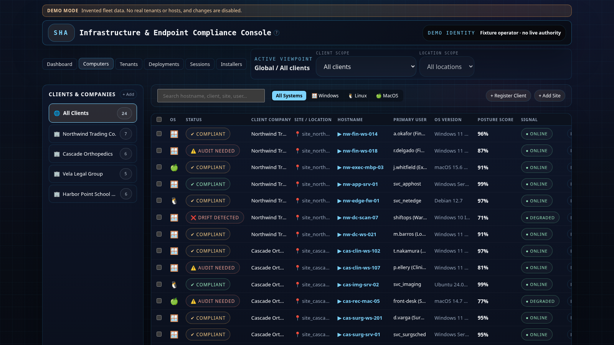

# Security Hardening Automation

Security Hardening Automation (SHA) is an early-stage security operations platform for organizations managing Windows, Linux, and macOS endpoints. It brings posture evidence, a control registry, human approvals, and bounded response actions into one operator workspace.



The screenshot uses the built-in demo mode, which serves only invented tenants and hosts.

## What it does

- Displays fleet/endpoints, posture, controls, installer profiles, approvals, and action history.
- Delivers typed response actions through short leases with authenticated result reporting.
- Supports OIDC browser sessions, scoped roles, enrollment tokens, and per-device credentials.
- Produces signed Go-agent development bundles and transitional compatibility reporters.
- Exports compliance evidence and deterministic contract schemas/source-pack catalogs.

## Current scope

The control plane and dashboard are working development slices. Native Go-agent capabilities differ by platform:

- Windows: posture reporting plus one reversible hardening action (Windows Firewall all profiles, with rollback).
- Linux: posture reporting. The Go agent does not apply hardening changes; the transitional compatibility reporter can apply and roll back SSH password-login and host network-isolation controls after approval.
- macOS: observe-only. The agent and reporter report posture, including Application Firewall, FileVault, and Gatekeeper, and refuse any change. An installer and agent end-to-end test runs on a GitHub-hosted macOS runner; there is no signed macOS package yet.

Compatibility scripts and native agent packages are separate paths, as detailed in the [agent guide](agent/README.md).

Short-lived enrollment and signed release manifests exist. Native DEB/RPM/MSI distribution, ecosystem signing, a signed macOS package, and broader production readiness remain gaps. Disruptive work requires typed approval, and every endpoint action is a typed, leased response action. The API has no shell, remote-desktop, or arbitrary-command endpoint; a route test checks for this. SHAna and wider guided-program automation remain product direction.

## Getting started

Use Python 3.13, uv, Node.js 24, and pnpm 10.28.0. In separate terminals:

```bash
cd backend
uv sync
uv run uvicorn app.main:app --host 127.0.0.1 --port 8010
```

```bash
cd frontend
pnpm install --frozen-lockfile
API_URL=http://127.0.0.1:8010 pnpm dev --port 3010
```

Open <http://127.0.0.1:3010>. Configure authentication before shared deployment. An explicitly enabled fixture-only demo is available without a backend; see the [project guide](docs/project-guide.md#demo-mode).

## Runtime, data, and integrations

FastAPI/SQLAlchemy and Next.js use Alembic-managed SQLite or PostgreSQL. The self-hosted HA Compose path uses PostgreSQL, backend replicas, and nginx; it does not constitute a managed production HA offering. Protected deployments need configured identity, HTTPS, secret files, and durable credential-HMAC key preservation.

Go agents enroll and send heartbeat/posture/action results. Signed archive releases use an external operator-controlled trust policy; package-contained examples cannot establish trust. The app runs without Agent Hub or external AI credentials. [Configuration and backup details](docs/project-guide.md) cover browser identity, key retention, uploads of posture evidence, and Compose overlays.

## Development and verification

```bash
(cd backend && uv run pytest)
(cd frontend && pnpm test && pnpm exec tsc --noEmit)
```

The author runs these through `st check`, a workspace tool that is not part of this repository; the commands above are the plain equivalents. The [project guide](docs/project-guide.md#test-typecheck-and-build) lists backend/frontend gates, schema/catalog generation, and isolated platform/HA checks. [Agent verification](agent/README.md) documents release-signature and package tests. Build/contract verification does not establish macOS runtime or production-distribution acceptance.

## Documentation

- [Project guide](docs/project-guide.md): setup, configuration, compatibility reporters, operations, tests, and licensing.
- [Current runtime contract](docs/architecture/current-runtime-contract.md) and [agent guide](agent/README.md).
- [Guided security program strategy](docs/plans/2026-08-25-sha-guided-security-program-strategy.md) and [HA deployment](deploy/ha/README.md).
- [License](LICENSE) and [notice](NOTICE): current releases use BUSL-1.1; consult the license for permitted uses and change terms.
